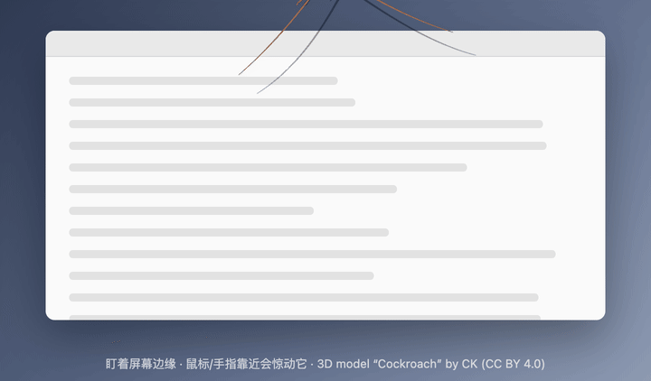
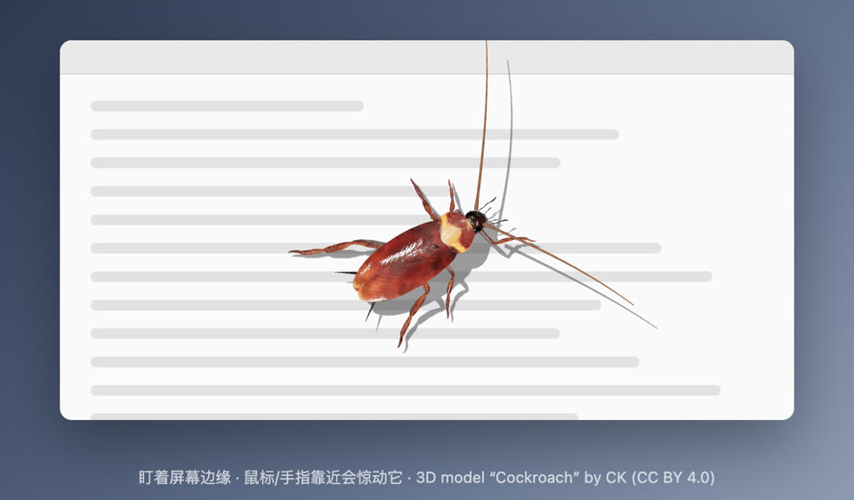

# RoachPet 3D 美洲大蠊桌宠

透明、点击穿透、置顶的全屏窗口，用 Three.js 实时渲染 3D 模型（带光照、反光和投影），模型和动画已内嵌进 index.html，无需额外文件。

## 运行
```bash
npm install
npm start                      # 默认 1 只
npx electron . --count=3       # 3 只
npx electron . --lurkMin=5 --lurkMax=15 --length=160
```

## 打包
```bash
npm run dist:mac   # dmg
npm run dist:win   # 免安装 exe
```

## 退出
`Cmd + Option + Shift + Q`（Windows：`Ctrl + Alt + Shift + Q`）

快捷键被别的软件占用时，点菜单栏（Windows 为托盘）里的蟑螂图标 →「退出 RoachPet」。

## 参数
| 参数 | 默认 | 说明 |
|---|---|---|
| count | 1 | 数量 |
| length | 130 | 体长 px |
| speed | 1100 | 冲刺速度 px/s |
| lurkMin / lurkMax | 20 / 75 | 每次潜伏秒数范围 |
| peekChance | 0.55 | 潜伏时探头概率 |
| freezeChance | 0.5 | 冲刺中途定住概率 |
| fleeRadius | 170 | 惊跑距离 px |
| sound | true | 爬行声，`--sound=0` 关闭 |
| antenna | 1.15 | 触须长度（体长的倍数） |
| lite | false | 省电模式，`--lite=1` 开启：像素比 1、阴影减半、潜伏时约 30 帧 |

## 触须
潜伏时头缩在屏幕外，只从边缘伸出两根触须：平时慢扫、突然弹一下、偶尔一动不动；光标靠近时两根触须会抽动着对准光标，再靠近就缩回去。
原模型的触须是绑死在头骨上的，`src/antennae.js` 把它们隐藏，换成可独立弯曲摆动的程序化触须。

## 性能
- 阴影只在每只蟑螂脚下的小范围里计算，不再整屏采样。
- 自动降画质：帧率低于 48 时，先逐级降低像素比（最低 1），再降低阴影精度。
- 配置一般的电脑可以直接用 `npx electron . --lite=1`。

## 修改触须或性能逻辑
`index.html` 是打包好的文件，自己写的模块放在 `src/`（`antennae.js` 触须、`perf.js` 性能）。改完后执行下面的命令，重新注入 index.html：
```bash
python3 tools/patch.py
```

## 协议
代码以 MIT 协议开源（见 LICENSE）。3D 模型不属于 MIT 范围，按下方 CC BY 4.0 署名使用。

## 署名
3D model: "Cockroach" by CK (https://sketchfab.com/xcellf), licensed under CC BY 4.0.
Source: https://sketchfab.com/3d-models/cockroach-cead55b8aa8643d48d67240bad028592
（贴图已缩至 1024 并转为 WebP 以减小体积）

# !!!恐虫注意!!!

以下有蟑螂实拍级 3D 预览，怕虫请就此打住。

<br>
<br>
<br>
<br>
<br>
<br>
<br>
<br>
<br>
<br>
<br>
<br>

潜伏：只从屏幕边缘伸出触须，光标靠近时触须会转过来对准它



全身


